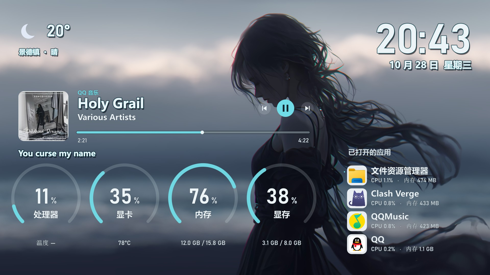

# GuojamView 源码

Windows 11 透明副屏监控。包含透明仪表盘、系统资源采集、QQ 音乐控制与同步歌词、天气显示和设置窗口。



## 运行

需要 Windows 11 x64 和 Python 3.13：

```powershell
python -m pip install -r requirements.txt
python app.py
```

首次运行默认选择副显示器。资源配置和日志保存在 `%LOCALAPPDATA%\GuojamView`。天气服务会查询所选城市；歌词功能会向 QQ 音乐歌词接口发送当前曲名和歌手名。

## 打包

```powershell
python build.py
```

生成 `dist\GuojamView.exe`（单文件）。

## 测试

```powershell
python -m unittest test_core test_media -v
```

原生窗口行为测试 `test_native.py` 和渲染测试 `test_visual.py` 需要在 Windows 桌面会话中运行。
